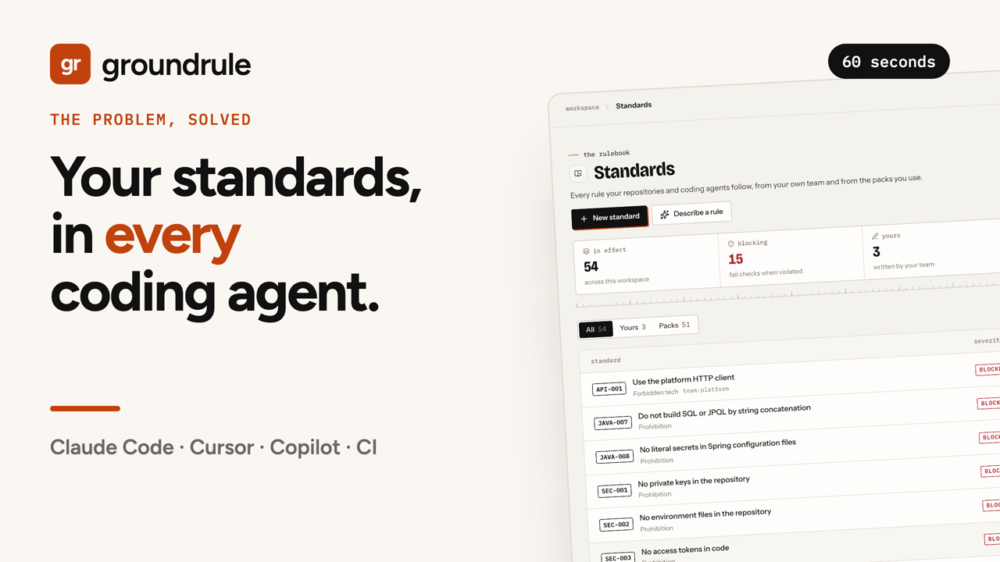

# Groundrule

[](https://www.npmjs.com/package/@groundrule/cli)
[](https://github.com/Metricall-AI-Lab/groundrule-oss/actions/workflows/ci.yml)
[](LICENSE)
[](https://docs.groundrule.dev)

**Your engineering standards, taught to every coding agent and checked on every PR.**

Write a standard once, as a small YAML file in git. Groundrule:

- **teaches your coding agents.** It generates `AGENTS.md`, `CLAUDE.md`, Cursor rules, and Copilot instructions containing only the standards that apply, without touching what you wrote by hand. An MCP server and stop hooks let Claude Code, Codex, Cursor and Copilot check their own changes before they finish.
- **checks the code.** It runs locally and in CI against your changes or the whole repository, with deterministic checks (files, patterns, dependencies, imports, layout, metrics, change sets), Semgrep, and optional AI checks on the Groundrule platform.
- **tells you why.** Every finding names the standard, shows the evidence, says how to fix it, and labels whether it came from a deterministic check or AI.

Everything in this repository works offline and without an account. The [Groundrule platform](https://groundrule.dev) adds a shared rulebook, staged rollout, hosted checks and a compliance report on top of it.

> **Status:** 0.x. Groundrule checks its own repositories with it. The document format is `groundrule.dev/v1alpha1` and may still change before 1.0; changes are announced in [Discussions](https://github.com/Metricall-AI-Lab/groundrule-oss/discussions).

## See it in 60 seconds

[](https://groundrule.dev)

## Quick start

Thirty seconds, no account, nothing leaves your machine:

```bash
npx @groundrule/cli init      # detects your stack, picks packs, writes .groundrule/config.yaml
npx @groundrule/cli sync      # writes AGENTS.md / CLAUDE.md / Cursor / Copilot instructions
npx @groundrule/cli check     # checks your uncommitted changes
```

```text
 groundrule check · 11 standards · 2 files changed

 ✕ TS-003  No eval or new Function
   BLOCKER · deterministic (regex)
   src/app.ts:3
     eval or new Function in application code
     3: return eval(input);
   → Parse the input instead: JSON.parse, a schema, or a lookup table of allowed operations.
   → groundrule explain TS-003

 Failed  ✓ 7 passed  ✕ 1 failed  ◇ 2 guidance  · 0.1s
```

## A standard

```yaml
apiVersion: groundrule.dev/v1alpha1
kind: Standard
metadata:
  id: DEP-008
  title: Use the platform HTTP client
  type: forbidden-tech
  owner: team:platform
spec:
  severity: warning
  requirement: Backend services must use @acme/http-client for outbound HTTP calls.
  examples:
    forbidden: ["import axios from 'axios'"]
  checks:
    - evaluator: dependencies
      forbid: [axios, got, node-fetch]
      allowInstead: ["@acme/http-client"]
```

More in [`examples/foundation`](examples/foundation/.groundrule/standards).

## Commands

| Command | What it does |
|---------|--------------|
| `groundrule init` | Create `.groundrule/config.yaml` with packs for your stack |
| `groundrule sync [--check] [--upload]` | Write (or verify) coding-agent instructions; `--upload` reports what the repository delivers to agents |
| `groundrule check [--base <ref>] [--all]` | Check changes, a branch, or everything. `-f json\|sarif\|markdown`, `--summary <file>` |
| `groundrule standards` | List the standards in effect |
| `groundrule keys generate` | Create a signing key pair for check results ([RFC 0008](rfcs/0008-signed-check-runs.md)) |
| `groundrule verify <run.json> --key <public.pem>` | Check a run's signature offline |
| `groundrule explain <ID>` | Why a standard exists, examples, how to comply, exceptions |
| `groundrule doctor` | Check configuration, tools, and agent files |
| `groundrule packs` | List bundled packs |
| `groundrule scan [--json] [--upload]` | Observe this repository against the whole catalog: stack, agent files, tools, and how every rule would do today. Changes nothing |
| `groundrule propose "<rule>"` | Propose a rule for your team to review on the platform. `--why`, `--example`, `--file path[:line]` |
| `groundrule mcp` | Serve your standards to coding agents over MCP, let them check their changes and propose rules (see below) |
| `groundrule hooks [--agents <list>] [--remove]` | Have Claude Code, Codex, Cursor, or Copilot run the check when they finish a task (see below) |
| `groundrule login` | Sign in to your organization on the Groundrule platform (browser approval) |
| `groundrule whoami` / `logout` | Show or remove (and revoke) your saved sign-in |

Exit codes: `0` passed, `1` failed, `2` configuration or usage error.

## Using the Groundrule platform (optional)

Everything above works offline. If your organization manages its standards on the Groundrule platform, connect a repository instead of listing packs:

```bash
npx @groundrule/cli login               # approve this computer in your browser
npx @groundrule/cli init --org acme     # writes platform: { org: acme } to .groundrule/config.yaml
npx @groundrule/cli sync                # your organization's rules, with every customization
```

`groundrule scan --upload` shares a scan with your organization so it can see which rules fit each repository. It also imports what you already have as proposals: instructions from AGENTS.md, CLAUDE.md, Cursor, and Copilot files; ESLint, Biome, Ruff, golangci-lint, Checkstyle, PMD, and tsconfig settings that match catalog rules; CODEOWNERS; and the architecture the code already keeps, as proposed boundary rules with the files that would fail each today ([RFC 0011](rfcs/0011-architecture-discovery.md); use `--no-import` to leave these out). Reports contain counts and at most three one-line, redacted snippets per rule (none for security rules, none at all with `--no-snippets`); `--json` shows exactly what would be sent. When uploading, the scan also tests your organization's own rules that have checks, drafts included, so you see their impact before publishing them.

`groundrule check --upload` sends the result to your organization as a compliance record ([RFC 0007](rfcs/0007-compliance-record.md)): which rules were in effect (as a digest anyone with the same rules can recompute), each rule's version, rollout stage and whether it could fail the change, the exceptions that applied, and which coding agents the change's commits declare, from `Co-Authored-By` trailers and bot authors (counts only; never commit messages or email addresses). Agent counts are a declaration, not proof; leave them out with `--no-authorship`.

With a signing key in CI (`groundrule keys generate`, then the private key as `GROUNDRULE_SIGNING_KEY`), every uploaded run is signed with Ed25519 ([RFC 0008](rfcs/0008-signed-check-runs.md)); `groundrule verify` proves later, offline, that a run wasn't altered. The signature covers everything but code snippets. In GitHub Actions, `--sigstore` signs with the job's own identity instead of a key ([RFC 0009](rfcs/0009-sigstore-keyless-signing.md), needs `id-token: write`; opt-in, since the identity and the result's hash go to Sigstore's public log).

What each command takes from the platform depends on the rule's rollout stage: `sync` writes rules at Teach, Advise, and Enforce into your agent files; `check` runs Enforce rules as set and Advise rules as warnings. Rules your repository defines in `.groundrule/standards/` still apply. In CI, set `GROUNDRULE_TOKEN` to a token from Settings → API tokens. Sign-ins are saved in `~/.config/groundrule/credentials.json`, readable only by you.

### Coding agents (MCP)

`groundrule mcp` is a [Model Context Protocol](https://modelcontextprotocol.io) server (stdio) with four tools:

- `list_standards`: the rules in effect in the repository, so the agent follows them. Works offline.
- `rules_for`: the rules that name the files the agent is about to change (by path or language), blocking first, with how to comply ([ADR 0010](docs/adr/0010-just-in-time-rules.md)). The server's instructions tell the agent to call it before editing a file; rules that apply everywhere stay in the agent file. Works offline.
- `check`: the same check CI runs, on the agent's uncommitted changes (or since a `base` ref, or `all` files). It lists only what the change introduced, with where and how to fix it, so the agent fixes it before it finishes. Works offline. In a repository connected to its workspace, the counts per rule are reported to the workspace (see below).
- `propose_rule`: when you correct your agent and say (or agree) that it should apply to everyone, it proposes the rule to your organization's review inbox, with where it came up. Nothing changes until a reviewer accepts it. Needs a connected repository and `groundrule login`.

Add it to your agent once per repository or user:

```bash
claude mcp add groundrule -- npx -y @groundrule/cli mcp          # Claude Code
```

```json
{ "mcpServers": { "groundrule": { "command": "npx", "args": ["-y", "@groundrule/cli", "mcp"] } } }
```

The JSON form goes in `.cursor/mcp.json` for Cursor, `.vscode/mcp.json` for VS Code (as `servers`), or your agent's MCP settings. Proposals carry the rule, your reason, and a file and line if given; nothing else from the repository is sent.

### Check when the agent finishes (hooks)

`groundrule hooks` adds a stop hook, so the agent runs the check every time it finishes a task, whether or not it remembered to:

```bash
npx @groundrule/cli hooks        # Claude Code, plus Codex, Cursor and Copilot if the repository uses them
```

| Agent | File | When the check fails |
|---|---|---|
| Claude Code | `.claude/settings.json` | The agent is stopped from finishing and told what to fix. A second hook tells it the rules for a file right before it edits it, once per file per session ([ADR 0010](docs/adr/0010-just-in-time-rules.md)) |
| Codex | `.codex/hooks.json` | The same; each developer trusts the hook once with `/hooks` |
| Cursor | `.cursor/hooks.json` | What to fix is sent as a follow-up message |
| Copilot (CLI and cloud agent) | `.github/hooks/groundrule.json` | The agent takes another turn with what to fix |

Existing settings and hooks are kept. The hook asks once per turn, so an agent that can't fix something isn't kept going forever, and it never fails the agent: without a Groundrule configuration it does nothing. Commit the files so every developer's agent runs it; `--remove` takes the hooks out again.

**What the workspace learns.** In a repository with `platform:` in its config, when this computer is signed in, the hook and the MCP `check` tool send the workspace a report after the agent has its answer ([RFC 0012](rfcs/0012-agent-check-reports.md)): the agent, which rules found something and how many times, how many files and rules were checked, and whether the agent was stopped. Never a path, a line, a snippet, or anything the agent or you wrote. It is sent with a two-second timeout and every failure is ignored, so it can't slow the agent or change the check. The workspace uses it to show how much is caught before a commit exists. `platform.reports: none` turns it off; `groundrule doctor` says which applies. Offline repositories send nothing.

## Checks

| Evaluator | Source | Use it for |
|-----------|--------|-----------|
| `files` | deterministic | Required or forbidden files (CODEOWNERS, `.env`) |
| `regex` | deterministic | Forbidden or required patterns in code |
| `dependencies` | deterministic | Forbidden packages (npm, Maven, Gradle, pip, Go, Cargo) |
| `change-set` | deterministic | Rules about a change ("entity changes need a migration") |
| `semgrep` | static analysis | Semgrep rules you already have |
| `llm` | AI | A question about the change, answered by Groundrule's hosted checks ([RFC 0013](rfcs/0013-ai-checks.md)); advisory, never fails a change. Reported as not run locally and in CI |

## Packs

`groundrule packs` lists the bundled packs (security, TypeScript/Node, React, Python, Java/Spring, Go, Docker, Kubernetes, Terraform, GitHub Actions, HTTP APIs, testing, AI agent hygiene). Your organization's own packs work the same way: `github:your-org/engineering-standards//packs/backend@v1`.

## GitHub

[`Metricall-AI-Lab/groundrule-action@v1`](https://github.com/marketplace/actions/groundrule-check) checks every pull request, writes a job summary, and uploads findings to code scanning. Source in [`action/`](action/README.md).

## Development

```bash
pnpm install
pnpm check
```

See [CONTRIBUTING.md](CONTRIBUTING.md). Groundrule checks itself: see [`.groundrule/`](.groundrule).

## License

[Apache-2.0](LICENSE). "Groundrule" is a trademark; see [GOVERNANCE.md](GOVERNANCE.md).
